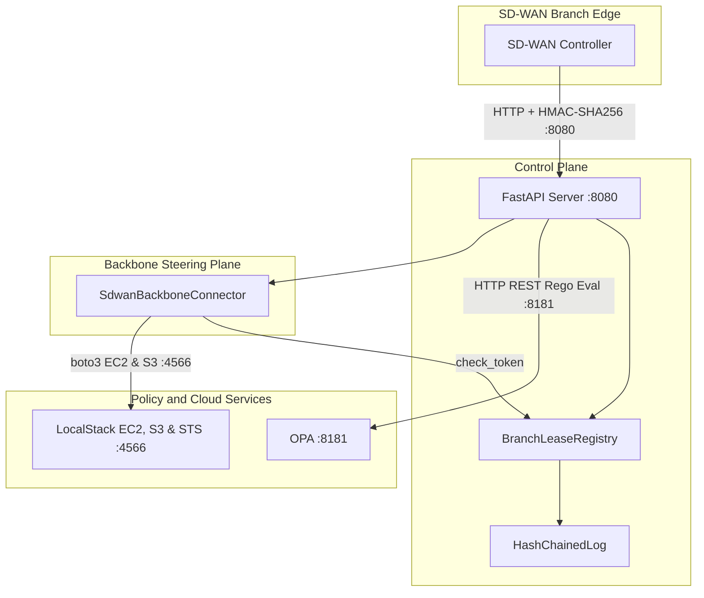
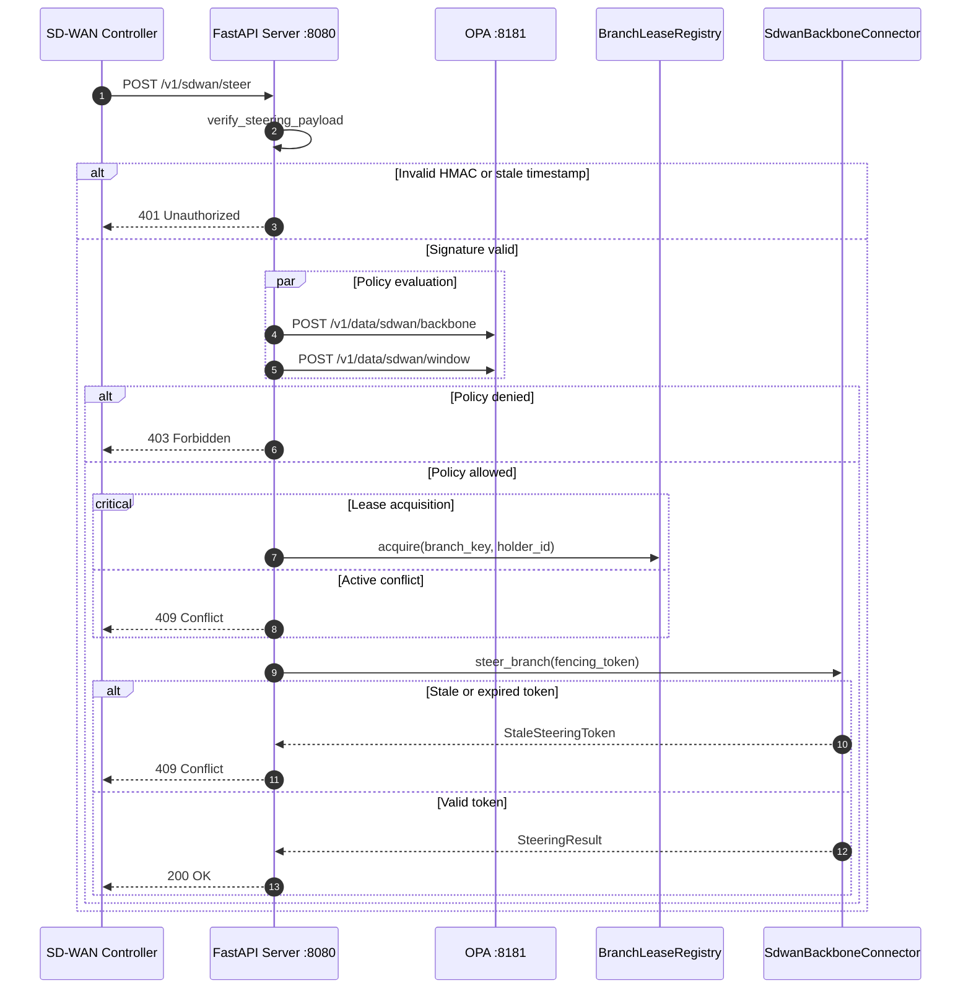
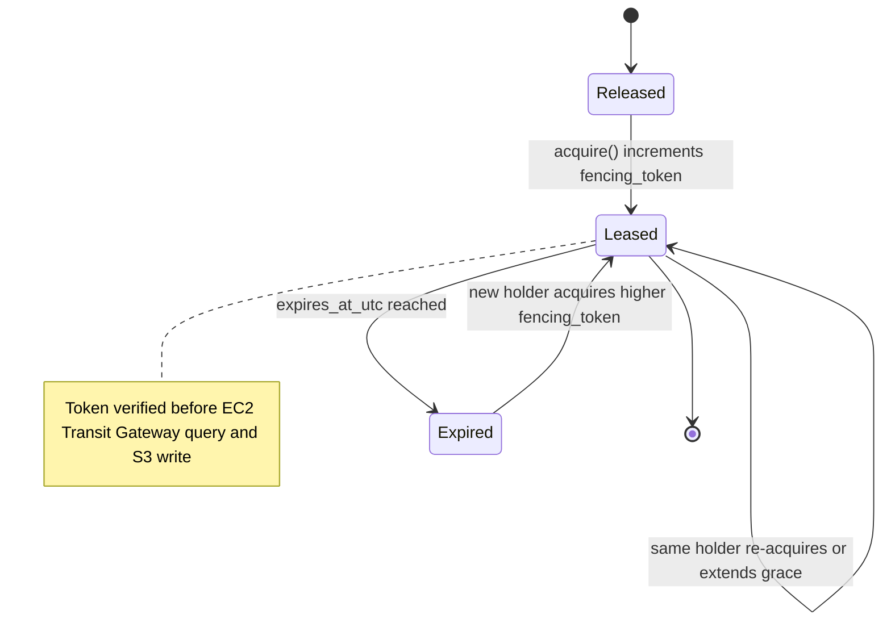

# Design Notes: SD-WAN Integration with Multicloud Backbones

This service separates branch lease tracking and SHA-256 hash-chained logging (`sdwan_bridge/steering.py`, `sdwan_bridge/server.py`, `ledger/hash_log.py`) from cloud backbone steering checks and S3 recording (`SdwanBackboneConnector`) with Open Policy Agent (OPA) policy evaluation.

## Trust-Boundary and Network Enclave Topology

## Steering and Failure Sequence

## Branch Lease State Machine

## Trade-Offs and Limitations

Lease expirations and UTC change windows use UTC timestamps so Daylight Saving Time transitions never shift allowed hours. Off-window steering changes permit up to a 15-minute grace lock when an active incident ID is supplied. AWS requests retry transient errors up to 4 times with per-retry sleep capped at `2.0s`.

Limitations: `BranchLeaseRegistry` and `HashChainedLog` are held in single-process memory rather than a shared database, and `describe_transit_gateways` reads the first page without `NextToken` pagination.
