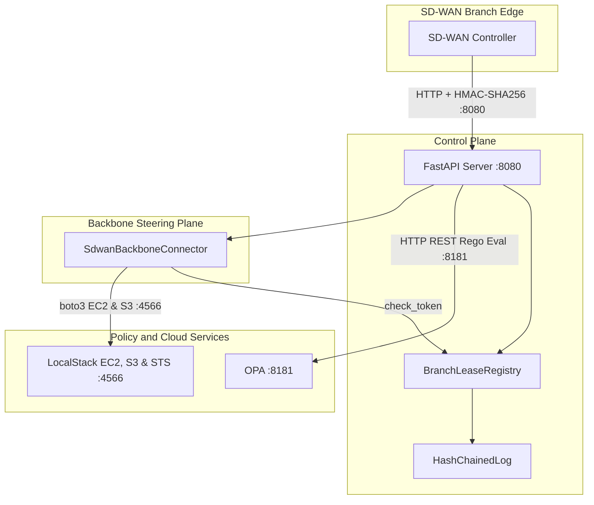

# sdwan-multicloud-backbone-bridge

Built and tested on Python 3.12.

Python FastAPI control plane and steering connector for routing SD-WAN branch traffic onto multicloud backbones (`aws-tgw`, `azure-vwan`, `gcp-ncc`) with monotonic fencing tokens, SHA-256 hash-chained log entries, OPA policies, and AWS EC2/S3 calls.



## Prerequisites

- Python 3.12+
- Docker and Docker Compose
- `curl` and `openssl`

## Environment Variables

| Variable | Default | Purpose |
| --- | --- | --- |
| `AWS_REGION` | `us-east-1` | AWS region for EC2, S3, and STS clients |
| `AWS_ENDPOINT_URL` | `http://localhost:4566` | LocalStack or custom AWS endpoint URL |
| `SDWAN_AUDIT_BUCKET` | `sdwan-multicloud-backbone-audit` | S3 bucket receiving steering records and preflight probes |
| `OPA_URL` | `http://localhost:8181` | Open Policy Agent base URL |
| `WEBHOOK_HMAC_SECRET` | `local-dev-sdwan-backbone-secret` | Shared secret for `X-Signature-256` verification |

## Setup Order and Commands

Start LocalStack (`ec2,s3,sts`) and OPA:

```bash
make up
```

Run the live preflight check (`make doctor`), seed initial branch mappings (`make seed`), and start the API server (`make run`):

```bash
make doctor
make seed
make run
```

Run unit, chaos, and benchmark checks:

```bash
make test
make chaos
make bench
```

Stop containers:

```bash
make down
```

## Sample Request

```bash
BODY='{"branch_id":"branch-lagos-01","cloud_backbone":"aws-tgw","sla_class":"low-latency-voice","bgp_asn":65100,"holder_id":"sdwan-edge-1","actor_role":"sdwan-ops"}'
TS=$(date -u +%s)
SIG="sha256=$(printf '%s.%s' "$TS" "$BODY" | openssl dgst -sha256 -hmac 'local-dev-sdwan-backbone-secret' | awk '{print $2}')"

curl -s -X POST http://localhost:8080/v1/sdwan/steer   -H "Content-Type: application/json"   -H "X-Timestamp: $TS"   -H "X-Signature-256: $SIG"   -d "$BODY"
```

## Measured Output

From running `python3 -m unittest discover -s tests -p "test_*.py" -v`:

- `Ran 5 tests in 0.096s` (`OK`).
- `BENCH lease+check+log (2000 ops): 72.98 ms (36.49 us/op)`.

## Common Errors and Fixes

- `x s3 write/delete probe failed on bucket=...: An error occurred (AccessDenied) when calling the PutObject operation`: the configured principal lacks `s3:PutObject` or `s3:DeleteObject` on `SDWAN_AUDIT_BUCKET`; grant write/delete permissions or verify `AWS_ENDPOINT_URL`.
- `x opa health check failed at http://localhost:8181`: OPA is not running or still starting; run `make up` and wait for health checks to succeed.

## Not Wired Yet

- No external relational or consensus store backing `BranchLeaseRegistry` or `HashChainedLog` across multiple instances.
- No direct SD-WAN controller or Azure vWAN / GCP NCC control-plane API clients; steering decisions are recorded to S3 after EC2 Transit Gateway inspection.
- No pagination loop over `describe_transit_gateways` `NextToken`.
